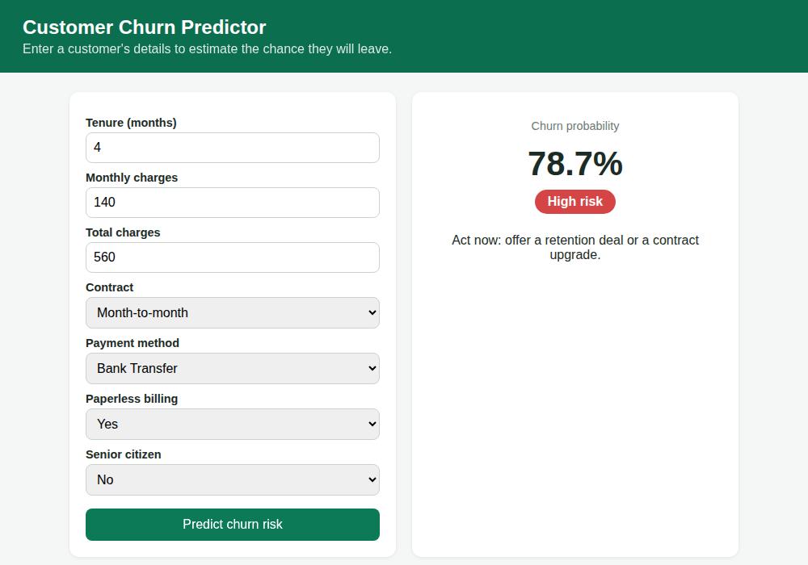

# Customer Churn Prediction: Data Science Capstone

   **Author:** Sumit Gupta | [GitHub](https://github.com/SumitGupta9627) | [LinkedIn](https://linkedin.com/in/sumit-gupta-99119b35b)
   
An end-to-end machine learning project that predicts which customers are about to leave, explains why, and serves predictions through a small web app.



## 1. Project overview

| | |
|---|---|
| **Business problem** | Keeping a customer costs far less than winning a new one. Find customers likely to churn so the retention team can contact them first. |
| **Data** | `customer_churn.csv` from the task portal: 500 customers, 9 columns, 10.6% churn |
| **Model** | Random Forest (tuned), compared with Logistic Regression and Gradient Boosting |
| **Result (unseen test set)** | ROC-AUC 0.997, Recall 1.00, Precision 0.61, Accuracy 0.93 |
| **Business impact** | Estimated net benefit of about 13,300 currency units on 500 customers (see assumptions in `reports/business_report.md`) |
| **Deployment** | Flask web app with a JSON API (`deployment/app.py`) |

**Key findings**
1. All churn happens in the first 12 months. After month 12 no customer in the data churned.
2. Month-to-month contracts churn at 20.6%, against 4.3% (one year) and 6.9% (two year).
3. New customers paying over 100 a month churn at 79%, against 38% for cheaper plans.

## 2. Setup instructions

Requires **Python 3.11 or newer** (the pinned library versions need it).

```bash
# 1. Go to the project folder
cd capstone_project

# 2. Create and activate a virtual environment
python -m venv .venv
# Windows:        .venv\Scripts\activate
# Mac / Linux:    source .venv/bin/activate

# 3. Install libraries
pip install -r requirements.txt

# 4. (Optional) Train the model again. A trained model is already included.
python -m src.train

# 5. Run the tests
python -m unittest discover -s tests

# 6. Start the web app, then open http://127.0.0.1:5000
python deployment/app.py
```

To run the notebook: `pip install jupyter`, then `jupyter notebook capstone_project.ipynb`. Start Jupyter **from the project root folder**.

> If `pip install` fails on an exact version, replace the `==` pins in `requirements.txt` with `>=` and try again.

## 3. Code structure

```
capstone_project/
├── README.md                     This file
├── requirements.txt              Library versions
├── capstone_project.ipynb        Main analysis (already executed)
├── src/
│   ├── config.py                 Paths, column names, constants
│   ├── data_loader.py            Load data + quality checks
│   ├── features.py               Feature engineering + preprocessing
│   ├── train.py                  Model comparison, tuning, saving
│   ├── evaluate.py               Metrics and plots
│   ├── predict.py                Input validation + prediction
│   └── business.py               Retention campaign money estimate
├── data/
│   ├── customer_churn.csv        Dataset from the task portal
│   └── data_dictionary.md        Column descriptions
├── reports/
│   ├── technical_documentation.md
│   ├── business_report.md
│   ├── metrics.json              Final test metrics
│   ├── business_impact.json      Campaign estimate
│   ├── test_results.txt          Output of the test run
│   ├── figures/                  Charts used in the notebook and slides
│   └── screenshots/              Screenshots of the running app
├── deployment/
│   ├── app.py                    Flask app (API + web page)
│   ├── templates/index.html      Frontend
│   ├── model.joblib              Trained model
│   └── Dockerfile                Optional container build
├── presentation/
│   └── capstone_presentation.pptx   13 slides
├── tests/                        16 automated tests
└── career/                       Resume, LinkedIn, interview prep
```

## 4. How to use the API

```bash
curl -X POST http://127.0.0.1:5000/predict \
  -H "Content-Type: application/json" \
  -d '{"Tenure":4,"MonthlyCharges":140,"TotalCharges":560,"SeniorCitizen":0,
       "Contract":"Month-to-month","PaymentMethod":"Electronic Check","PaperlessBilling":"Yes"}'
```

Response:

```json
{"churn_probability": 0.8372, "prediction": 1, "risk_level": "High"}
```

Risk levels: **Low** (below 30%), **Medium** (30% to 60%), **High** (60% or more). Bad input returns HTTP 400 with a clear message.

## 5. Technical details

- **Preprocessing:** numeric columns scaled, categories one-hot encoded, all inside one scikit-learn `Pipeline` so the same steps run in training and in the app.
- **Features added:** `AvgMonthlySpend`, `IsNewCustomer` (tenure <= 12), `HighCharges` (monthly > 100).
- **Validation:** 80/20 stratified split, 5-fold cross-validation on the training part only, grid search over 27 Random Forest settings.
- **Imbalance:** handled with `class_weight="balanced"`.
- Full explanation: `reports/technical_documentation.md`.

## 6. Testing evidence

16 automated tests cover data quality, feature engineering, model quality, input validation, the API and the business calculation. All pass. See `reports/test_results.txt`.

Screenshots: `reports/screenshots/` (home page, high-risk result, low-risk result, input error).

## 7. Limitations

The dataset is small (500 rows) and simulated: `TotalCharges` does not equal `Tenure x MonthlyCharges`, and churn follows clear rules. The near-perfect scores will therefore be lower on real company data. The test set has only 11 churners, so use the cross-validation AUC (0.993) as the more stable number.
